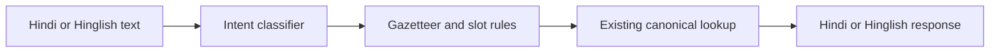

# Accessible Hindi / Hinglish Transport Assistant Using NLP

Academic prototype report - 12 October 2026. This report describes the implemented case study and its actual measurements. Generated data and development checks do not establish real-passenger accuracy.

## Problem and scope

The project demonstrates understanding Hindi and Hinglish transport questions for a limited Chennai case study. The system classifies intent, extracts known places and transport-related slots, looks up curated source records or the existing canonical service, and produces a Hindi or Hinglish response. The interface exposes the intermediate NLP results so the method and errors can be examined.

The four context-selector examples are Chennai Central, Chennai Egmore, Tambaram and Avadi; curated examples also include Airport, Koyambedu and Guindy. Typed-name recognition uses the full original canonical snapshot and its stored aliases. Route and timetable coverage remains incomplete. The scope stays a local academic prototype.



Nine intents cover route queries, availability, scheduled service timing, station information, accessibility, ticketing, current train status, railway complaints and out-of-scope questions. Unknown transport locations remain transport questions; an unresolved place does not make the intent out of scope.

## Data and annotation

There are 1,652 intent examples: 1,452 template variants, 20 short synthetic seeds and 180 varied AI-authored development examples. All generated rows are explicitly unreviewed. Hindi contributes 1,090 rows and Hinglish 562. The split is 1,112 training / 216 validation / 324 test. Related Hindi/Hinglish template families and their place/politeness substitutions stay within one partition. The varied development pairs belong only to training and replace repetitive rows instead of increasing the corpus.

The linked slot dataset has 320 rows, with 72 generated test queries. A separate development diagnostic contains 90 AI-authored questions in 45 bilingual scenarios. Four user-authored Hinglish questions are retained separately. Exact diagnostic/user questions are excluded from training. Diagnostic failures did inform a general training-data correction, so these checks are development-exposed rather than an independent holdout. Two data versions were trained with the same settings; no hyperparameter search was run.

The [annotation guide](../data/project/ANNOTATION_GUIDE.md) distinguishes scheduled time from current train status, routes from availability, and ordinary station details from accessibility. Human review of wording, labels and slot annotations remains outstanding.

## Method

**Baseline:** character TF-IDF n-grams of lengths 2-5, sublinear term frequency, and Logistic Regression with C=4, max_iter=1000 and seed 42. Character features tolerate some Hindi/Hinglish spelling variation. This is the default demo model because it has the stronger validation macro F1.

**MuRIL:** the existing transport-trained checkpoint supplies starting weights. Only encoder layers 10 and 11 and a new nine-class linear head are trained. Embeddings and the earlier encoder layers remain frozen. Attention-masked mean pooling supplies the classification representation. Training uses five epochs, batches of 16, AdamW, encoder learning rate 0.00005, head learning rate 0.001, weight decay 0.01 and gradient clipping at 1.0. Seed is 42; input is raw text truncated to 64 tokenizer tokens. Epoch 1 is selected using validation macro F1 only. This is partial fine-tuning of reused weights, not a fresh pretrained-model benchmark.

**Entities and lookup:** the existing canonical gazetteer identifies station, bus-stop and landmark names and stored aliases. The seven curated locations are not a recognition whitelist. Existing read-only route and timetable services are reused for additional lookups. Duplicate physical names require clarification. Hindi `से`, Hinglish `se` and simple qualifiers resolve origin roles; mode, first/last-service type, accessibility feature and complaint type use explicit rules. There is no learned NER model. Rules do not override the displayed classifier intent. Nearby transport requests keep the location anchor separate from the requested bus/Metro target. The station selector supplies context only for explicit references such as `is station`.

The curated catalog has eight directed Metro links, two bus snapshot connections, two Central Metro accessibility facts and one historical terminal-service window. Two supplementary Central/Velachery MRTS guidance records name Park Town as the separate boarding/alighting station. Nearby searches keep the station anchor separate from the target mode; an official Guindy Metro stop-name fallback avoids unreliable coordinate estimates. Bus records retain canonical route/direction/boarding/alighting IDs. The timing illustration is explicitly dated 16 October 2024 and cannot establish a current, railway or destination-specific departure. Missing records produce clarification or unavailable responses. Complaint recognition does not file a complaint; ticketing/status recognition does not book or track trains.

## Measured results

Validation macro F1: TF-IDF 0.981; MuRIL 0.882.

**Generated template-family test partition:**

| Model | Language | Rows | Accuracy | Macro F1 |
| --- | --- | --- | --- | --- |
| tfidf | hi | 216 | 96.3% | 0.962 |
| tfidf | hinglish | 108 | 100.0% | 1.000 |
| muril_finetuned | hi | 216 | 83.3% | 0.832 |
| muril_finetuned | hinglish | 108 | 69.4% | 0.660 |

**Development-exposed AI diagnostic:**

| Model | Intent accuracy | Macro F1 | Pipeline success |
| --- | --- | --- | --- |
| tfidf | 95.6% | 0.955 | 93.3% |
| muril_finetuned | 82.2% | 0.791 | 80.0% |

Pipeline success requires correct intent, evaluated slots, response status and exact catalog record IDs, with source attribution for returned records. It does not measure response fluency, complete answer semantics or physical travel feasibility. The diagnostic's slot F1 is 1.000 for both models; this mainly measures the curated example locations, not all database names, unknown-name span detection or general NER. Original expected statuses are retained: broader-name ambiguity can now yield clarification where the seven-name lookup returned unavailable. The linked 72-query synthetic slot test also has F1 1.000. These small generated-data measurements must not be presented as perfect real-world extraction.

The complete [classification evaluation](NLP_EVALUATION.md) contains confusion matrices and per-class results. The [pipeline evaluation](PIPELINE_EVALUATION.md) retains failed questions and exact user-check responses. Common remaining confusions include scheduled times versus train delays and non-transport questions phrased with travel-like wording. MuRIL also confuses some coach-facility complaints and performs worse on out-of-scope inputs.

## User questions and development findings

In the first pass, TF-IDF correctly classified only one of the user's four intents. Unfamiliar station names led to station-information predictions, and a first-train query was classified as current status. Three varied route scenario pairs and five scheduled-rail scenario pairs replaced development examples, without increasing dataset size or changing training settings. Both final models now classify all four intents correctly. These questions informed development and do not estimate unseen-user accuracy.

| User input | Final baseline intent | Response status |
| --- | --- | --- |
| Guindy se Central kaise jayein? | route_query | information |
| Velachery se Park station kaise jayein? | route_query | clarification |
| Chennai Central se Mambalam station kaise jau? | route_query | clarification |
| Subah sabse pehle train guindy se chennai central kab hai? | service_timing | unavailable |

Guindy to Central receives a published Blue Line Metro connection. Velachery, Park and Mambalam are now recognized from the original database. Park/ Park Town and physical-stop collisions require qualification. Explicit railway names resolve, but railway routes and departure schedules are absent from the snapshot. Correct intent, name recognition and factual answer coverage are separate capabilities.

## Demo and reproduction

The interface preserves the original theme and fonts. Example selection fills the draft without inference; new-question reset keeps the language/model preference. Answer status and sources are visible, slots are readable, and raw records remain expandable. An on-demand comparison runs both models on the same submitted question and saved station context. Changed drafts/settings leave the prior result clearly labeled.

Follow the [five-minute demo guide](DEMO_GUIDE.md). Show one Hindi Metro query, switch the saved response to Hinglish, demonstrate a bus snapshot, a Metro lift query, a railway complaint, a live-status limitation and an ambiguous station name or missing railway route. Then compare the two models using the visible evaluation.

```bash
python -m scripts.nlp_v2.build_project_dataset
python -m scripts.nlp_v2.train_project
python -m scripts.nlp_v2.evaluate_project
streamlit run app/streamlit_app.py --server.address=127.0.0.1
python -m pytest -q
```

The submitted runtime includes the baseline, nine-class head, pinned tokenizer and canonical database. Large encoder assets are distributed through a versioned release and verified during setup. Inference uses local files and needs no private checkpoint or Hugging Face cache. The exported encoder produced bit-for-bit identical features on 94 diagnostic/user questions. Shared lookup regressions remain in the submission; the retired API and earlier classifier are removed. Follow the README for a fresh Python 3.12 environment and model setup.

## Limitations and bounded follow-up

The corpus is generated and lacks human annotation review. Template-family separation does not remove shared vocabulary or sentence structures, and the reused checkpoint has prior transport exposure. Development-exposed checks cannot support a blind accuracy claim. The curated catalog supplies seven example locations; recognition searches the full canonical snapshot. The snapshot is incomplete, includes duplicates and lacks suburban-rail/MRTS route sequences and schedules. Stored bus schedules do not confirm current service; no verified walking-access network is available. Confidence scores are uncalibrated. Complex negation, multiple competing intents and unfamiliar names can still fail. The five Hindi-Tamil phrases require Tamil-speaker review. Speech and general translation are optional future demonstrations.

The useful next academic work is a small human-reviewed corpus and a fresh natural evaluation set, followed by analysis of the retained errors. The present deliverable is the working local prototype, reproducible experiment, transparent results and demo explanation.

## References

- Supplied original project description: accessible Hindi transport NLP case study and its explicit core/optional scope.
- [Khanuja et al., MuRIL: Multilingual Representations for Indian Languages](https://arxiv.org/abs/2103.10730).
- [Scikit-learn: TF-IDF vectorizer](https://scikit-learn.org/stable/modules/generated/sklearn.feature_extraction.text.TfidfVectorizer.html) and [Logistic Regression](https://scikit-learn.org/stable/modules/generated/sklearn.linear_model.LogisticRegression.html).
- [CMRL Metro line map](https://chennaimetrorail.org/wp-content/uploads/2023/11/Line-Map.pdf) and [Central Metro station page](https://chennaimetrorail.org/station-information/puratchi-thalaivar-dr-m-g-ramachandran-central-metro/).
- [CMRL publication, 16 October 2024](https://chennaimetrorail.org/wp-content/uploads/2024/10/Press-Release-16.10.2024-English.pdf) and [current timetable page](https://wcag.chennaimetrorail.org/time-table/).
- [ChennaiGTFS community feed](https://github.com/ungalsoththu/ChennaiGTFS), used through the existing attributed local snapshot.
